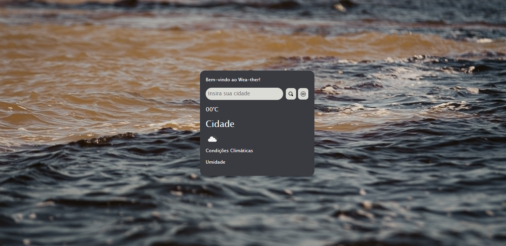

# 🌦️ Wea-ter

## 📌 Descrição do Projeto

O **Wea-ter** é uma aplicação web que permite ao usuário pesquisar o clima de qualquer cidade e visualizar as condições atuais — como **temperatura**, **umidade** e descrição do tempo — com uma interface **simples e intuitiva**.

Uma das principais funcionalidades é a **busca por voz**: em vez de digitar o nome da cidade, o usuário pode falar diretamente para obter as informações meteorológicas. Isso torna a experiência mais acessível e moderna.

O projeto é **open source** e desenvolvido com tecnologias web tradicionais, facilitando contribuições da comunidade e aprendizado para novos desenvolvedores.

---

## 🛠️ Tecnologias Usadas

Este projeto é construído com:

- **HTML5** – estrutura da interface
- **CSS3** – estilos visuais e responsividade
- **JavaScript (Vanilla)** – lógica de funcionamento, requisições e DOM
- **Web Speech API** – recurso de reconhecimento de voz para buscar cidades por comando de voz
- **Fetch API** – para requisições em tempo real à API de clima
- **Netlify** – hospedagem do site  
(Links e dependências diretamente no repositório) :contentReference[oaicite:0]{index=0}

---

## 🚀 Funcionalidades

✔️ Busca de clima por **texto**  
✔️ Busca de clima por **voz** (voz para texto)  
✔️ Mostra **temperatura** atual  
✔️ Mostra **umidade**  
✔️ Interface responsiva para dispositivos móveis  
✔️ Deploy automático com Netlify :contentReference[oaicite:1]{index=1}

---

## 🧠 Como Funciona

1. O usuário digita ou usa o botão de voz para informar a cidade.  
2. O app usa a **API de clima** para buscar dados atualizados.  
3. Os dados são exibidos na tela em tempo real com temperatura e umidade.  
4. A busca por voz usa a **Web Speech API** para transformar fala em texto automaticamente. :contentReference[oaicite:2]{index=2}

---

## 📌 Compatibilidade da Busca por Voz

Antes de usar a voz, veja se o navegador suporta a API:  
👉 https://developer.mozilla.org/en-US/docs/Web/API/SpeechRecognition#browser_compatibility  
(A página mostra quais navegadores conseguem usar reconhecimento de voz) :contentReference[oaicite:3]{index=3}

---

## 📍 Link do Website

👉 https://wea-ther.netlify.app

---

## 📸 Tela do App



---

## 📁 Estrutura Básica do Projeto

- `index.html`: interface principal  
- `css/style.css`: estilos visuais  
- `js/script.js`: lógica da busca de clima e voz

---

## 🛠️ Começando

1. **Clone o repositório**  
   ```bash
   git clone https://github.com/brxzjunior/Weather

